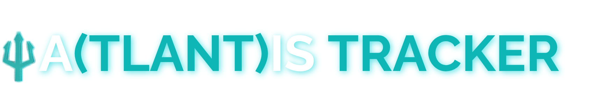

# AIS collector
<p align="center">
  
</p>
Streams live AIS ship messages from [aisstream.io](https://aisstream.io) into PostgreSQL, built to run unattended on a Raspberry Pi for months. It reconnects on its own, survives database hiccups and power cuts, and keeps a gap log that explains every missing stretch of data: feed dropped, feed went quiet, collector stopped, or collector crashed.

Every message is stored complete and unfiltered (`payload` column), with MMSI, ship name and position pulled out into their own columns for fast queries.

## Setup on the Pi

Assumes PostgreSQL is installed with the `ais` user and `ais` database.

**1. Get an API key.** Go to aisstream.io, sign in with GitHub, and create a key under API Keys.

**2. Get the code onto the Pi.** From GitHub (replace with your repository's address):

```bash
git clone https://github.com/YOUR-NAME/ais-collector.git ~/ais-collector
```

Or from the zip, if you downloaded it on the Pi:

```bash
unzip ~/Downloads/ais-collector.zip -d ~
```

Any folder works; the steps below assume `~/ais-collector`.

**3. Install the Python packages** in a virtual environment:

```bash
cd ~/ais-collector
python3 -m venv venv
venv/bin/pip install -r requirements.txt
```

**4. Add your settings:**

```bash
cp .env.example .env
nano .env          # paste your API key and the ais database password
chmod 600 .env     # only you can read it
```

**5. Create the tables:**

```bash
psql -h localhost -U ais -d ais -f schema.sql
```

It should end with `schema is up to date: version 2`.

**6. Test run** in the terminal:

```bash
venv/bin/python collector.py
```

You should see `feed connected` and `subscription confirmed by server`. After a minute, a stats line shows messages per second. Every line starts with the version that wrote it, like `[0.3.0+git.1a2b3c4]`. Press Ctrl-C to stop; it shuts down cleanly and records that it did.

**7. Check the data:**

```bash
psql -h localhost -U ais -d ais -f queries.sql
```

**8. Run it permanently** as a service that starts at boot and restarts itself. From inside the collector folder:

```bash
sed -e "s|__USER__|$USER|g" -e "s|__DIR__|$PWD|g" ais-collector.service | sudo tee /etc/systemd/system/ais-collector.service
sudo systemctl daemon-reload
sudo systemctl enable --now ais-collector
```

Day to day:

| What | Command |
|---|---|
| Is it running? | `systemctl status ais-collector` |
| Live logs | `journalctl -u ais-collector -f` |
| Restart after editing settings | `sudo systemctl restart ais-collector` |
| Stop | `sudo systemctl stop ais-collector` |

Only one copy can run at a time. If you start a second one (say, from Thonny while the service is running), it refuses with a clear message instead of storing duplicates.

## Status display (optional)

A LilyGO T-Dongle-S3 plugged into the Pi can show the collector's health at a glance: green when collecting, orange or red when something's wrong, blinking red if the Pi goes quiet. Setup, including flashing the dongle from a Mac, is in [`display/README.md`](display/README.md).


## The gap log

`SELECT * FROM collection_gaps ORDER BY gap_start DESC;` lists every break in coverage with its cause:

| cause | meaning |
|---|---|
| `disconnected` | the connection dropped; the collector reconnected on its own |
| `stale` | connected but nothing arrived for `STALE_SECONDS`, so it forced a reconnect |
| `error` | the server sent an error, such as an invalid API key |
| `collector_stopped` | you stopped it deliberately (or the Pi shut down normally) |
| `collector_crashed` | crash, kill or power loss, timed from the last message written |
| `buffer_full` | partial loss: the database was down so long the memory buffer filled; the detail says how many messages were lost |

Gap starts use the time of the last message actually received, not when the problem was noticed. Each gap also shows the collector version running when it began, so if crashes start after an update, you'll see it. `feed_coverage` shows the opposite view: every window when the feed was connected. The raw history lives in `collector_runs` and `feed_events`.

## Versions and updates

The version appears in three places: at the start of every log line, in `collector_runs.version` for each run, and, through `ais_raw.run_id`, for every stored message. It looks like this:

| Version | Meaning |
|---|---|
| `0.3.0+git.1a2b3c4` | running from a git checkout at commit `1a2b3c4` |
| `0.3.0+git.1a2b3c4.modified` | same commit, but files were edited and not committed |
| `0.3.0+file.5d06c90e` | not a git checkout (e.g. unzipped); the suffix is a fingerprint of `collector.py`, so it changes if the code is edited |

The number part (`0.3.0`) comes from `VERSION` in `collector.py`, and the suffix is worked out locally at startup, so nothing needs a network connection. To find which version stored a message: `SELECT a.*, r.version FROM ais_raw a JOIN collector_runs r USING (run_id) ...`

**Putting it on GitHub.** The folder is ready to push as is: `.gitignore` keeps `.env` (your keys) and `venv/` out of the repository. The easiest way is GitHub's own command-line tool, run once from inside the folder:

```bash
sudo apt install gh
gh auth login                      # follow the prompts; choose HTTPS and log in with a browser
git init -b main && git add . && git commit -m "AIS collector 0.3.0"
gh repo create ais-collector --private --source=. --push
```

The last line creates the repository on GitHub and pushes to it in one go. Use `--public` instead of `--private` when you're ready to share it. If git asks who you are, set it once with `git config --global user.name "Your Name"` and `git config --global user.email you@example.com`. Once the folder is a git checkout, versions include the commit automatically.

**Updating to a new version:**

1. Get the new files: `git pull` (or replace the files, keeping your `.env`, then commit)
2. `venv/bin/pip install -r requirements.txt` (only matters if requirements changed)
3. `psql -h localhost -U ais -d ais -f schema.sql` (safe every time; upgrades in place without touching data)
4. `sudo systemctl restart ais-collector`

If you forget step 3 after a schema change, the collector won't start and says exactly what to run. `CHANGELOG.md` lists what changed in each version.

**Releasing your own change:** bump `VERSION` in `collector.py`, add a line to `CHANGELOG.md`, commit, and optionally tag it (`git tag v0.4.0`). If you change `schema.sql`, also bump `SCHEMA_VERSION` in `collector.py` and the `schema_version` value at the bottom of `schema.sql`.

## Testing without the real feed

`tools/fake_aisstream.py` imitates aisstream.io locally, so you can try everything without an API key, and rehearse failures:

```bash
venv/bin/python tools/fake_aisstream.py --rate 20          # terminal 1
AISSTREAM_URL=ws://localhost:8765 venv/bin/python collector.py   # terminal 2
```

Add `--drop-after 30` to cut the connection every 30 seconds, `--stall-after 30` to go silent while staying connected, or run the collector with `AISSTREAM_API_KEY=bad` to see the error path. Fake data lands in the same tables, so clear it afterwards if you used your real database: `TRUNCATE ais_raw, feed_events, collector_runs RESTART IDENTITY;`

## Thonny

Thonny is fine for reading and editing the code. To run it inside Thonny, point Thonny at the virtual environment first: Tools → Options → Interpreter → "Alternative Python 3 interpreter or virtual environment" → `~/ais-collector/venv/bin/python`. For long-term collection, use the service, since closing Thonny stops the script.

## Settings

All in `.env`:

| Variable | Default | Meaning |
|---|---|---|
| `AISSTREAM_API_KEY` | (required) | your aisstream.io key |
| `PGHOST` `PGPORT` `PGDATABASE` `PGUSER` `PGPASSWORD` | | standard PostgreSQL connection settings |
| `AIS_BBOXES` | `10,-83,31,-59` | `lat_min,lon_min,lat_max,lon_max`; several boxes separated by `;`. The default is the Caribbean basin, from the Florida peninsula and Keys to Trinidad |
| `AIS_MESSAGE_TYPES` | everything | comma-separated message types to keep, e.g. `PositionReport,ShipStaticData` |
| `STALE_SECONDS` | `300` | force a reconnect after this long without messages |
| `QUEUE_MAX` | `100000` | messages held in memory while the database is unavailable |
| `BATCH_SIZE`, `FLUSH_SECONDS` | `500`, `1.0` | messages are written at most once per second, in batches |
| `HEARTBEAT_SECONDS` | `10` | how often the run's heartbeat and counters are updated |
| `AISSTREAM_URL` | aisstream's server | change only for testing with the fake server |

## Notes

- All times are stored as UTC.
- Monthly partitions (`ais_raw_2026_10`, ...) are created automatically, a couple of months ahead. That sets up the monthly export to Parquet: archive a month, then drop its partition to free space.
- Free AIS feeds depend on volunteer receivers, so coverage around Haiti may be thinner than around Florida. Check the vessels-per-hour numbers in `queries.sql` after a few days.
