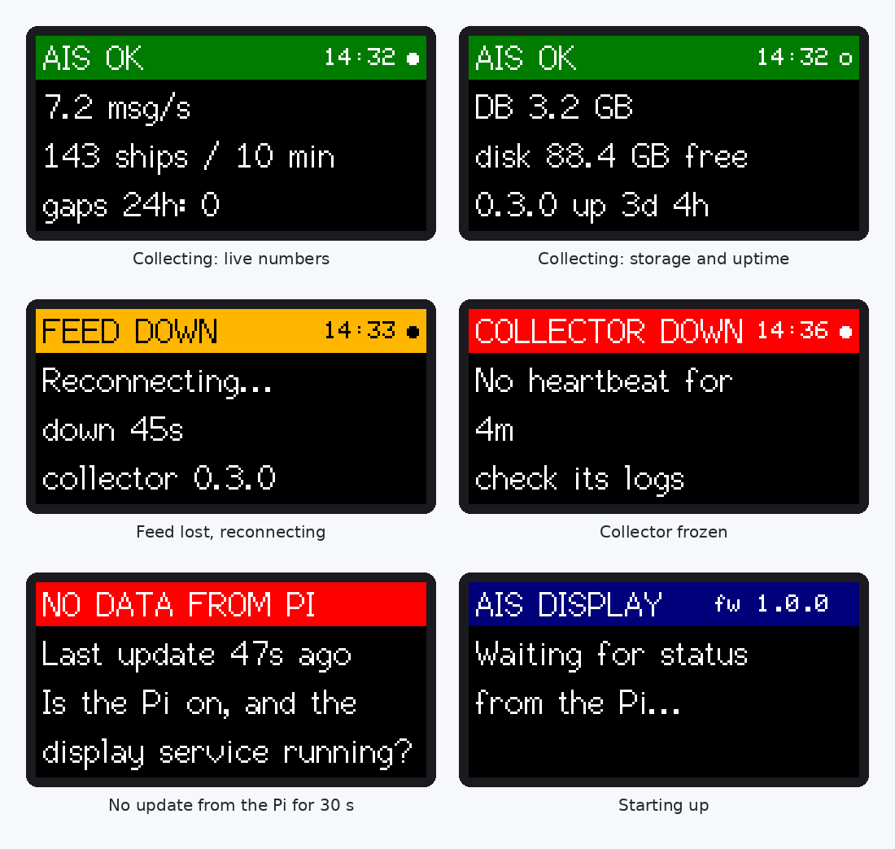

# Status display (LilyGO T-Dongle-S3)

A thumb-sized screen plugged into the Pi that shows at a glance whether the collector is healthy. Green means all good, orange means something needs a look, red means data isn't being collected, and blinking red means the Pi itself has gone quiet.



*Rendered from the firmware's own drawing code and fonts, so text and layout match the screen exactly; the real panel's colours look slightly different.*

Two parts:

- **`ais_status_display/`**: firmware for the dongle. You flash it once from your Mac. It only draws what it's sent, so it never needs reflashing when the screens change.
- **`status_display.py`**: runs on the Pi. Every 5 seconds it checks the collector in the database (read-only) and sends a status line over USB. It runs as its own service, separate from the collector, so a display problem can never interrupt collection.

## What the screen shows

| Header | Meaning |
|---|---|
| `AIS OK` (green) | Collecting. Alternates every 10 s between messages per second, ships in the last 10 minutes and gaps in the last 24 hours, and database size, free disk space, version and uptime |
| `FEED DOWN` (orange) | Lost the aisstream connection; the collector is reconnecting on its own |
| `NO MESSAGES` (orange) | Connected, but nothing has arrived for 60 seconds |
| `BUFFER FULL` (orange) | The database was unavailable long enough that messages were lost in the last 10 minutes |
| `CONNECTING` / `NOT STARTED` (orange) | The collector just started, or has never run |
| `FEED ERROR` (red) | aisstream sent an error, such as an invalid API key |
| `COLLECTOR OFF` (red) | The collector was stopped and isn't running |
| `COLLECTOR DOWN` (red) | The collector is running but frozen: no heartbeat for over a minute |
| `DB DOWN` / `NO SCHEMA` (red) | PostgreSQL isn't answering, or `schema.sql` hasn't been applied |
| `NO DATA FROM PI` (blinking red) | No update for 30 seconds: the Pi is off or frozen, or the display service stopped |
| `SCRIPT STOPPED` (orange) | The display service was stopped deliberately |

The LED matches the header colour. The small dot at the top right flips on every update, so you can see it's alive.

**Button** (the BOOT button on the dongle): a short press turns the screen off or on, and the LED keeps showing the status. Hold it for 2 seconds to turn the picture upside down, if the screen is upside down in your Pi's USB port. The dongle remembers this.

## 1. Flash the dongle (on your Mac, once)

**Install the Arduino IDE:**

```bash
brew install --cask arduino-ide
```

**Add ESP32 support:** open the Arduino IDE, then go to Arduino IDE → Settings. In *Additional boards manager URLs*, paste:

```
https://espressif.github.io/arduino-esp32/package_esp32_index.json
```

Then go to Tools → Board → Boards Manager, search **esp32**, and install **esp32 by Espressif Systems** (3.3.0 or newer). It's a large download.

**Install LilyGO's display library.** Their copy of TFT_eSPI is preconfigured for this screen; the one in the Library Manager isn't, and would leave the screen blank. In Terminal:

```bash
git clone --depth 1 https://github.com/Xinyuan-LilyGO/T-Dongle-S3.git ~/Downloads/T-Dongle-S3
mkdir -p ~/Documents/Arduino/libraries
rm -rf ~/Documents/Arduino/libraries/TFT_eSPI
cp -R ~/Downloads/T-Dongle-S3/lib/TFT_eSPI ~/Documents/Arduino/libraries/
```

Restart the Arduino IDE so it sees the library.

**Open the firmware:** File → Open → `display/ais_status_display/ais_status_display.ino` in this folder.

**Set the board** under the Tools menu:

| Setting | Value |
|---|---|
| Board | ESP32S3 Dev Module |
| Port | `/dev/cu.usbmodem…` |
| USB CDC On Boot | Enabled |
| USB Mode | Hardware CDC and JTAG |
| Flash Size | 16MB (128Mb) |
| Partition Scheme | 16M Flash (3MB APP/9.9MB FATFS) |
| PSRAM | Disabled |

**Upload** with the → button. If the upload fails or no port appears, unplug the dongle, hold its BOOT button while plugging it back in, and upload again. Afterwards, unplug and replug it without the button.

The screen should show **AIS DISPLAY: Waiting for status from the Pi**, with a blue LED.

**Test it** (optional) with the demo, which cycles through sample screens. Close the Serial Monitor first if it's open, since only one program can use the port at a time:

```bash
cd ~/Downloads/ais-collector
python3 -m venv venv && venv/bin/pip install pyserial
venv/bin/python display/status_display.py --demo
```

Press Ctrl-C to stop; the screen shows `SCRIPT STOPPED`, then `NO DATA FROM PI` after 30 seconds. That's the watchdog working.

## 2. Use it on the Pi

**Update the code and packages:**

```bash
cd ~/ais-collector
git pull
venv/bin/pip install -r requirements.txt
```

**Plug the dongle into the Pi** and check it's seen. This should list a device with `Espressif` in its name:

```bash
ls /dev/serial/by-id/
```

**Check you're allowed to use serial ports.** This should print `dialout`:

```bash
groups | grep -o dialout
```

If it prints nothing, run `sudo usermod -aG dialout $USER`, then log out and back in (or reboot).

**Test run:**

```bash
venv/bin/python display/status_display.py
```

The screen should switch to the live status within 5 seconds. Press Ctrl-C to stop.

**Run it permanently** as a service. From inside the collector folder (not the display folder):

```bash
sed -e "s|__USER__|$USER|g" -e "s|__DIR__|$PWD|g" display/ais-display.service | sudo tee /etc/systemd/system/ais-display.service
sudo systemctl daemon-reload
sudo systemctl enable --now ais-display
```

Check it with `systemctl status ais-display` and `journalctl -u ais-display -f`.

## Settings

In `.env`, shared with the collector:

| Variable | Default | Meaning |
|---|---|---|
| `DISPLAY_DISK_PATH` | `/` | which disk's free space to show; set it to the SSD's mount point if you move the database there |

To print the status lines instead of sending them, without a dongle: `venv/bin/python display/status_display.py --print`. If auto-detection picks the wrong device, pass it explicitly with `--port /dev/ttyACM0`.

## Protocol

One line of ASCII per update, fields separated by `|`:

```
S|<level>|<title>|<corner>|<line 1>|<line 2>|<line 3>
```

`level` is `OK`, `WARN` or `ERR`; `corner` is the small text at the right of the header (the time). Anything that can write a line to the serial port can drive the screen, so other feeds can reuse it later.
